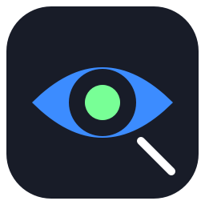
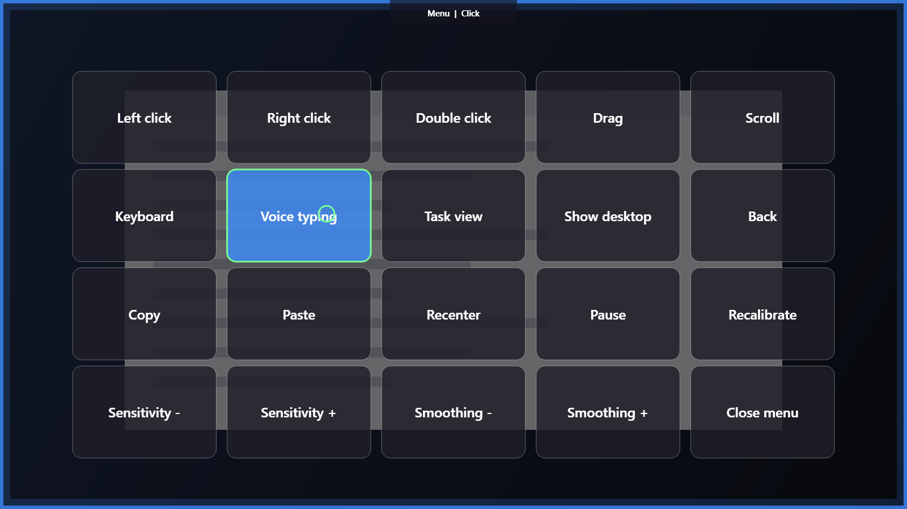
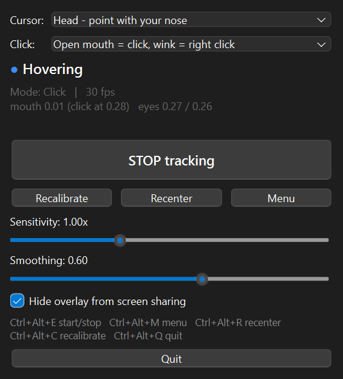
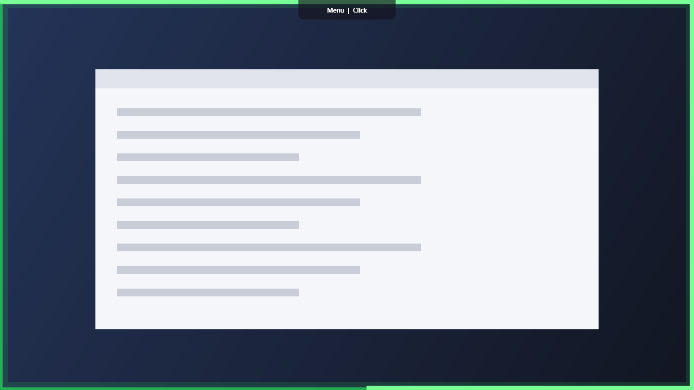
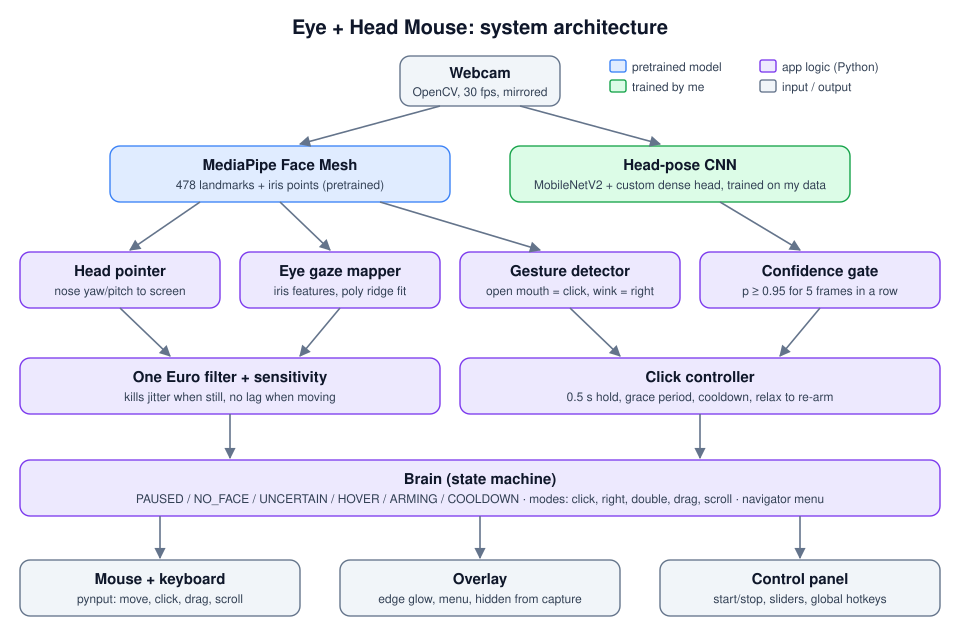
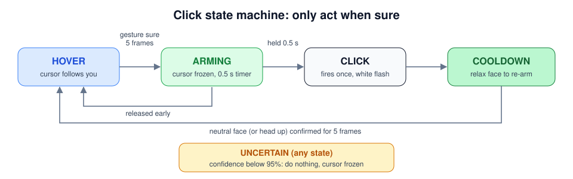

<div align="center">



# Eye + Head Mouse

**Control your Windows PC hands-free with your webcam. Point with your head or eyes, and click with a facial gesture.**

[](#installation)
[](https://www.python.org/)
[](https://onnxruntime.ai/)
[](https://developers.google.com/mediapipe)
[](https://www.riverbankcomputing.com/software/pyqt/)
[](LICENSE)



</div>

---

## Overview

Eye + Head Mouse turns an ordinary webcam into a complete mouse replacement. A **head-pose neural network
that I trained on my own data** runs alongside Google's MediaPipe face mesh. On top of them sits a
real-time control system with a confidence gate, signal smoothing, a click state machine, drag and
scroll modes, and a gaze-friendly navigator menu.

The core design rule is **only act when sure**: nothing is clicked unless the model has been at least
95% confident for 5 frames in a row. Anything less is treated as *uncertain*, and the app does nothing.

## Features

| | |
|---|---|
| **Head pointing** | Point your nose at the screen; reaches every corner, steady and low-lag |
| **Eye gaze pointing** | Optional iris-tracking mode with a 9-point calibration |
| **Gesture clicks** | Open your mouth to left-click, wink to right-click. Normal blinks are ignored |
| **Head-nod clicks** | Alternative click method driven by my custom-trained CNN |
| **Confidence gate** | p &ge; 0.95 for 5 consecutive frames, otherwise no action |
| **0.5 s click hold** | Each click needs a deliberate hold, and the face must relax before the next click can arm |
| **Drag and scroll modes** | Grab-and-drop with two gestures, and gaze-zone scrolling |
| **Navigator menu** | 20 large tiles: right/double click, drag, scroll, on-screen keyboard, voice typing, task view, copy/paste, recenter and more |
| **Edge-glow feedback** | Screen border shows the state: hovering, clicking countdown, uncertain, paused |
| **Hidden from screen share** | The overlay and panel are excluded from Zoom, Teams, OBS and screenshots (`WDA_EXCLUDEFROMCAPTURE`) |
| **Live tuning** | Sensitivity and smoothing sliders, global hotkeys, settings remembered between runs |

<p align="center">
  
  &nbsp;&nbsp;
  
</p>

## Installation

### Option A: installer script (recommended)

Requires **Windows 10/11**, a webcam and **Python 3.12** ([download](https://www.python.org/downloads/release/python-3128/)).

```powershell
git clone https://github.com/Ninjacat10/eye-head-mouse.git
cd eye-head-mouse
powershell -ExecutionPolicy Bypass -File install.ps1
```

This creates a virtual environment, installs the dependencies, and adds **Eye + Head Mouse** shortcuts to
your Desktop and Start Menu. After that, just double-click the icon.

### Option B: prebuilt app

Download `EyeHeadMouse-vX.Y.Z-windows-x64.zip` from [Releases](../../releases), unzip it, and run
`EyeHeadMouse.exe`. No Python needed.

> The executable is not code-signed. Windows SmartScreen may warn you (choose *More info, Run anyway*),
> and PCs with **Smart App Control** turned on will block it. In that case, use Option A.

## Usage

1. Launch the app and wait for the control panel to show **Paused** (about 5 s).
2. *(Optional, recommended)* Click **Recalibrate** and point your nose at the 9 dots with a relaxed face.
3. Press **Start tracking** or `Ctrl+Alt+E`.

| Action | How |
|---|---|
| Move cursor | Turn your head (head mode) or look (eye mode) |
| Left click | Open your mouth and hold for 0.5 s |
| Right click | Wink one eye and hold for 0.5 s |
| Open the menu | Point at the **Menu** tab at the top centre of the screen, then click |
| Drag | Menu > Drag: click to grab, move, click to drop |
| Scroll | Menu > Scroll: point at the top or bottom of the screen; click to exit |

| Hotkey | Action |
|---|---|
| `Ctrl+Alt+E` | Start / stop tracking (always works, even if the cursor is out of control) |
| `Ctrl+Alt+M` | Open / close the navigator menu |
| `Ctrl+Alt+R` | Recenter head pointing |
| `Ctrl+Alt+C` | Recalibrate |
| `Ctrl+Alt+Q` | Quit |

**Edge-glow colours:** blue = hovering · green = click countdown · white flash = clicked ·
amber = not sure · orange = dragging · purple = scrolling · red = paused.

## System design

<p align="center"></p>

Each frame from the webcam goes down two paths at the same time:

1. **Pointing.** MediaPipe Face Mesh gives 478 facial landmarks. In head mode, the nose's position
   relative to the cheeks (yaw) and the eye line (pitch) is mapped to the screen by a per-user linear fit.
   No jaw points are used, so opening your mouth to click never moves the cursor. In eye mode, the iris
   position inside each eye socket goes through a degree-2 polynomial ridge regression fitted during
   calibration. Both feed a **One Euro filter**, which smooths heavily when you are still and lightly
   when you move fast.
2. **Clicking.** Either the gesture detector (mouth-gap and per-eye openness ratios compared with your
   calibrated neutral face) or my head-pose CNN produces an UP / DOWN / uncertain signal. This goes
   through the confidence gate and then the click state machine.

<p align="center"></p>

The cursor only moves in the **HOVER** state, so it freezes as soon as a gesture starts. The click
lands where you were pointing 150 ms *before* the gesture began.

## The model I trained

| | |
|---|---|
| Task | Binary head-pose classification: *head up (hover)* vs *head down (click)* |
| Data | My own webcam images, collected and labelled by me |
| Training | Transfer learning in Google Teachable Machine |
| Architecture | MobileNetV2 (&alpha; = 0.35, 224&times;224) feature extractor &rarr; GlobalAveragePooling &rarr; Dense(100, ReLU) &rarr; Dense(2, softmax) |
| Deployment | Rebuilt the network in Keras from the raw TF.js `weights.bin` (all 263 tensors mapped by name), then exported it to ONNX. The ONNX output matches Keras to within 1e-7 |
| Inference | ~4 ms per frame on CPU with ONNX Runtime, about 4&times; faster than TensorFlow, with no TensorFlow dependency in the app |

Re-export after retraining: replace `models/head_model_tfjs/`, then run `python -m tools.export_onnx`
(requires `requirements-dev.txt`).

## Project structure

```
eye-head-mouse/
├── app.py                     # entry point
├── install.ps1 / launch.vbs   # installer + windowless launcher
├── models/
│   ├── head_model_tfjs/       # my Teachable Machine export
│   └── head_model.onnx        # runtime model
├── src/
│   ├── main.py                # threads + wiring (Qt UI thread, vision worker thread)
│   └── eyemouse/
│       ├── camera.py          # webcam capture
│       ├── eye_tracker.py     # landmarks -> pose, iris, mouth, eye features
│       ├── head_classifier.py # CNN rebuild, TF.js weight loader, ONNX inference
│       ├── confidence_gate.py # "only act when sure"
│       ├── gestures.py        # open-mouth / wink detection
│       ├── head_pointer.py    # head mode mapping + recenter
│       ├── gaze_mapper.py     # eye mode calibration regression
│       ├── smoothing.py       # One Euro filter + sensitivity
│       ├── click_controller.py# hold timer, grace period, cooldown
│       ├── scroll_drag.py     # modes, scrolling, dragging
│       ├── state_manager.py   # the Brain: states, modes, navigator menu
│       ├── cursor_controller.py
│       ├── overlay.py         # edge glow, menu, capture exclusion
│       ├── calibration_ui.py
│       ├── control_panel.py   # UI + global hotkeys
│       ├── config.py          # every tunable number
│       └── paths.py           # source vs packaged paths
├── tools/export_onnx.py
├── packaging/                 # PyInstaller spec, icon + screenshot generators
└── docs/images/               # diagrams and screenshots
```

## Configuration

All thresholds live in [`src/eyemouse/config.py`](src/eyemouse/config.py):
`confidence_threshold`, `frames_required`, `click_delay_s`, `cooldown_s`, `mouth_open_delta`,
`eye_closed_frac`, `scroll_speed` and more. Per-user calibration and settings are stored next to the
app when run from source, or in `%APPDATA%\EyeHeadMouse` for the packaged build.

## Development

```powershell
py -3.12 -m venv .venv
.\.venv\Scripts\Activate.ps1
pip install -r requirements-dev.txt
python app.py                                          # run from source
pyinstaller packaging/EyeHeadMouse.spec --noconfirm    # build the .exe
```

## Roadmap

- [ ] Multi-monitor support
- [ ] More gesture options (cheek puff, eyebrow raise)
- [ ] Dwell-click option (click by holding still)
- [ ] Signed installer

## Acknowledgements

- [MediaPipe Face Mesh](https://developers.google.com/mediapipe) for the face and iris landmarks
- [Teachable Machine](https://teachablemachine.withgoogle.com/), used to train the head-pose classifier
- Casiez et al., [*1€ Filter*](https://gery.casiez.net/1euro/) (CHI 2012), for jitter smoothing

## License

[MIT](LICENSE) © Ninjacat10
